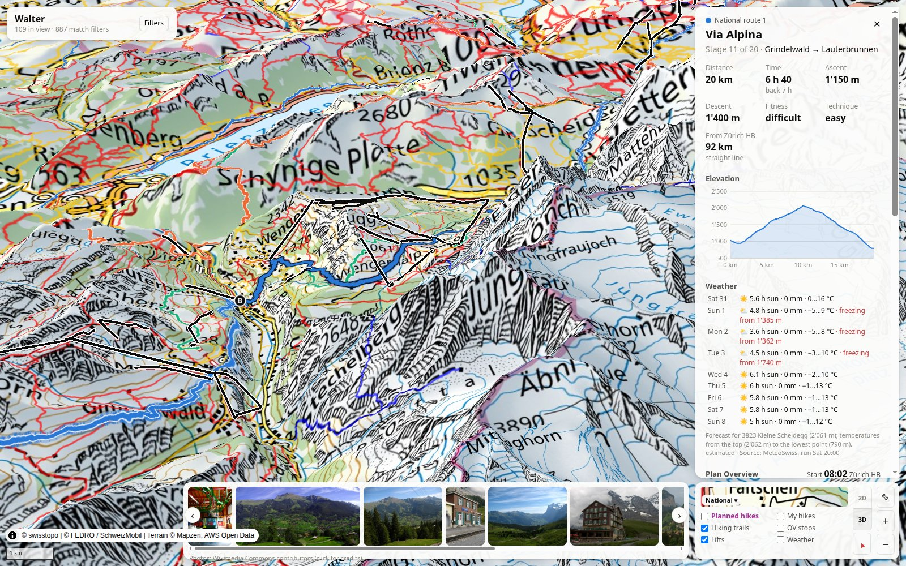

# Walter

Turn a Google Maps Timeline history into a personal hiking map: find the hikes in it, show them over
swisstopo maps, and track how much of the Swiss hiking network (SchweizMobil routes, swissTLM3D trails)
has been covered.

Status: data validation (M0) and the web app skeleton (W0).



## Quick start

Needs Docker (with Compose v2.24+) and [just](https://just.systems).

```bash
just preview    # dev stack with hot reload, opens http://localhost:5173
just deploy     # production-style stack on this machine, http://localhost:8080
just down       # stop the stack (database is kept)
just nuke       # stop the stack and delete the database
just otp-stop   # stop OpenTripPlanner, if started with `just otp` (~6 GB RAM)
just            # list all tasks
```

The stack is PostGIS (with pgRouting), a FastAPI API, the Martin tile server and a React + MapLibre
frontend, all bound to `127.0.0.1`. Details: [app/README.md](app/README.md).

## Data pipeline

Scripts that turn the raw exports into GeoJSON or load them into PostGIS. Run them from the repo root with the
project venv: `python3 -m venv .venv && .venv/bin/python -m pip install -r data/requirements.txt`.

| Script | Input | Output |
|---|---|---|
| `data/ingest/detect_hikes.py` | Timeline on-device export, `data/raw/Timeline_full.json` | `data/processed/walks.geojson`: merged walks with stats and a `kind` (hike / long_walk / walk) |
| `data/ingest/load_hikes.py` (`just load-hikes`) | `data/processed/walks.geojson` | PostGIS table `my_hike` (the hikes, for the "My hikes" map layer) |
| `data/ingest/swisstopo_tours.py` | swisstopo app GPX exports, `data/raw/swisstopo/` | `data/processed/swisstopo_tours.geojson` |
| `data/preprocessing/schweizmobil_routes.py` | `data/ref/wanderland_2056.gpkg` (geo.admin STAC, `ch.astra.wanderland`) | `data/processed/schweizmobil_routes.geojson` |
| `data/preprocessing/load_schweizmobil.py` (`just load-schweizmobil`) | `data/ref/wanderland_2056.gpkg` | PostGIS tables `sm_route`, `sm_stage`, `sm_stage_profile` (stack must be running) |
| `data/preprocessing/download_tlm_strassen.py` (`just download-tlm`) | geo.admin STAC, `ch.swisstopo.swisstlm3d` (shapefile zip) | `data/ref/swisstlm3d/swissTLM3D_TLM_STRASSE.*`, only the roads and paths layer |
| `data/preprocessing/load_trails.py` (`just load-trails`) | `data/ref/swisstlm3d/swissTLM3D_TLM_STRASSE.shp` | PostGIS tables `trail_vertex`, `trail_edge`: the hiking trails as a pgRouting graph, for drawing planned hikes |
| `data/preprocessing/trim_gtfs.py` (`just otp-build`) | Swiss GTFS feed, `data/ref/otp/gtfs.zip` | `data/ref/otp/graph/gtfs.zip`, trimmed to the reference weekend, and the OTP graph |
| `data/preprocessing/travel_times.py` (`just travel-times`) | stages in PostGIS, start station from `config.local.json`, OTP (`just otp`) | PostGIS table `sm_stage_travel` |
| `app/prototype/build_hikes_map.py` | the three files above | `data/processed/hikes_map.html`, a standalone Leaflet map |

To get the Timeline export: on Android, *Settings → Location → Location services → Timeline → Export
Timeline data*; on iOS, *Google Maps → Settings → Personal content → Export Timeline data*.

## Configuration

Copy `config.example.json` to `config.local.json` (git-ignored) and set the station trips start and end at (`travel.from_station`), plus
when you usually travel. `config.py` loads it.

## Repo layout

```
app/            web app: backend/ (FastAPI), frontend/ (React), infra/ (compose, Martin), prototype/
data/ingest/    import personal data (Timeline, GPX)
data/preprocessing/  prepare public Swiss data
data/raw/       personal exports       ┐
data/ref/       downloaded open data   ├ git-ignored
data/processed/ generated output       ┘
```

## Privacy

Timeline data contains home, work and every place visited. It stays on this machine: `data/raw/`,
`data/ref/`, `data/processed/`, `data/samples/` and `config.local.json` are git-ignored, and the generated
maps (for example `hikes_map.html`) contain personal locations, so don't publish them.

## Data and licences

- swisstopo base maps, swissTLM3D and swissALTI3D: open government data, attribution "© swisstopo".
- SchweizMobil routes (`ch.astra.wanderland`) via geo.admin.ch: open use, source must be given,
  attribution "© FEDRO / SchweizMobil".
